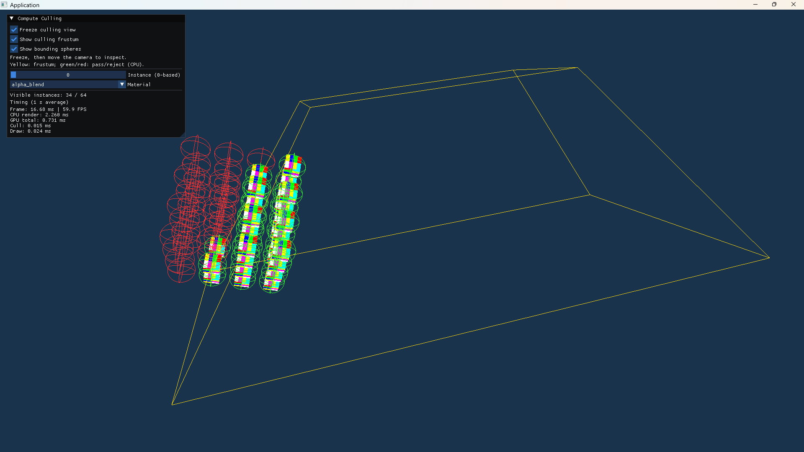
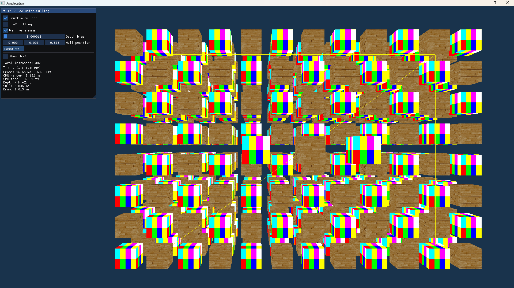
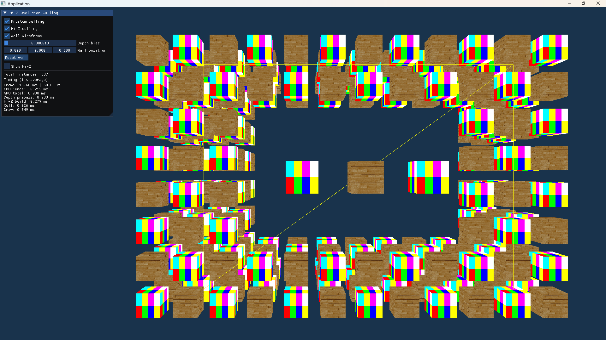
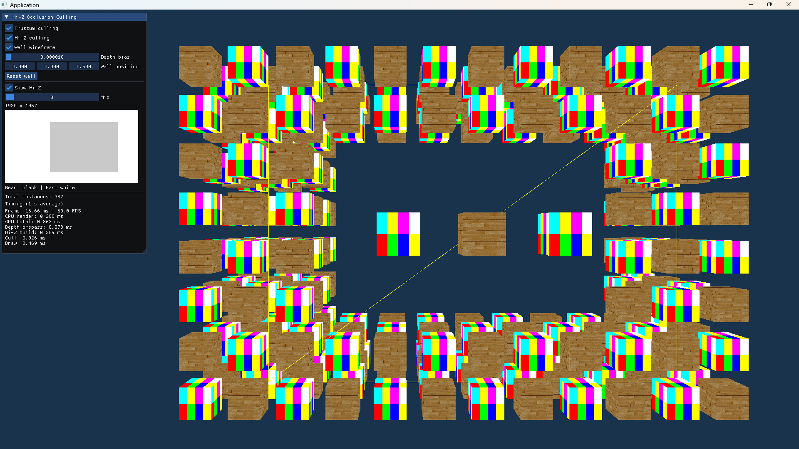
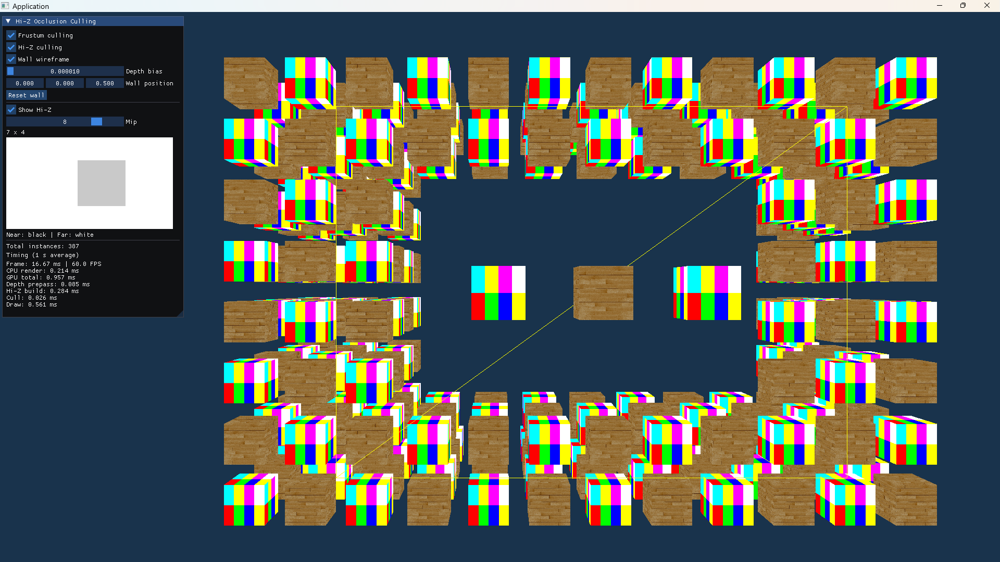
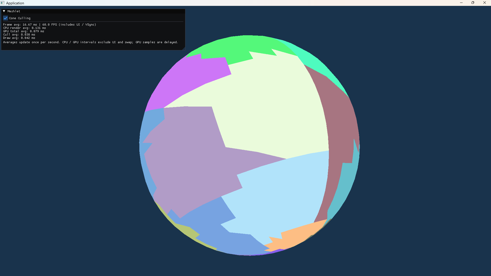

# Modern OpenGL Examples

使用 C++20 和 OpenGL 4.6 实现的一组独立图形示例，围绕实例数据、GPU 剔除、间接绘制和 Mesh Shader 展开。每个示例保留自己的数据组织和渲染流程，便于直接阅读 CPU 与 Shader 之间的数据流。

主要技术点包括 SSBO / UBO 数据布局、Bindless 资源访问、Compute Shader、GPU 内存屏障、Indirect Draw、Hi-Z 遮挡剔除和 Meshlet 绘制。



冻结剔除视角后独立移动观察相机：黄色线框为剔除视锥，红绿包围球展示 CPU 视锥测试结果；面板中 GPU 回读的可见实例数为 34 / 64。

## 示例

| 可执行目标 | 展示内容 | 入口 |
| --- | --- | --- |
| `base` | 纹理立方体、索引绘制与相机控制 | [代码](src/examples/base/main.cpp) |
| `bindless_texture` | 驻留纹理句柄与 Bindless 纹理采样 | [代码](src/examples/bindless/texture_main.cpp) |
| `bindless_buffer` | GPU Buffer 地址与 Shader 顶点读取 | [代码](src/examples/bindless/buffer_main.cpp) |
| `gpu_scene` | SSBO 实例与材质数据、运行时材质切换 | [代码](src/examples/gpu_scene/main.cpp) |
| `compute_culling` | GPU 包围球视锥剔除、CPU 回读计数、冻结视锥与包围球显示 | [代码](src/examples/compute_culling/main.cpp) |
| `indirect_draw` | Compute 生成可见实例列表和绘制命令，直接由 GPU 间接绘制 | [代码](src/examples/indirect_draw/main.cpp) |
| `hzb` | 遮挡体深度、最大深度金字塔、实例遮挡剔除与 Mip 预览 | [代码](src/examples/hzb/main.cpp) |
| `meshlet` | meshoptimizer 划分 Meshlet、视锥与法线锥剔除、Multi-Draw Indirect | [代码](src/examples/meshlet/main.cpp) |
| `mdi_count` | 紧凑间接命令列表，由 GPU 计数器决定实际提交的绘制命令数量 | [代码](src/examples/mdi_count/main.cpp) |
| `mesh_shader` | `GL_NV_mesh_shader` 路径，在 Mesh Shader 中完成视锥判断与几何输出 | [代码](src/examples/mesh_shader/main.cpp) |

推荐阅读顺序：`base` → `gpu_scene` → `compute_culling` → `indirect_draw` → `hzb`；Meshlet 相关实现可按 `meshlet` → `mdi_count` → `mesh_shader` 阅读。

各条路径的数据流和实现区别见 [GPU Driven Rendering](docs/gpu_driven_rendering.md)。

## 构建与运行

### 环境

- CMake 3.26 或更高版本、Ninja，以及支持 C++20 / `std::format` 的编译器。
- 现有预设使用 Windows x64 / MSVC，可在 Visual Studio 的 x64 Developer PowerShell 中执行下面的命令。
- 支持 OpenGL 4.6 Core 的显卡与驱动；部分示例还要求以下扩展。

| 示例 | 额外要求 |
| --- | --- |
| `bindless_texture` | `GL_ARB_bindless_texture` |
| `gpu_scene`、`compute_culling`、`indirect_draw`、`hzb` | `GL_ARB_bindless_texture`、`GL_ARB_gpu_shader_int64` |
| `bindless_buffer` | `GL_NV_shader_buffer_load` |
| `mesh_shader` | `GL_NV_mesh_shader` |

NV 扩展示例需要驱动提供对应扩展。启动时控制台会输出 GPU、OpenGL 和 GLSL 信息。

GLAD、GLFW、GLM、Dear ImGui、stb 和 meshoptimizer 的源码位于 [third_party](third_party/README.md)，由 CMake 构建，无需单独下载这些依赖。

### 截图与运行环境

| 项目 | 环境 |
| --- | --- |
| 操作系统 | Windows 11 |
| Vendor | NVIDIA Corporation |
| Renderer | NVIDIA GeForce RTX 5060/PCIe/SSE2 |
| OpenGL / 驱动 | 4.6.0 NVIDIA 580.97 |
| GLSL | 4.60 NVIDIA |
| C++ 编译器 | MSVC 14.44，x64 |
| CMake / 生成器 | CMake 4.0.0 / Ninja |
| 构建预设 | `msvc-debug-tidy`：Debug，`ENABLE_CLANG_TIDY=ON` |

全部示例已在上述环境下手动运行通过。

### 资产

示例使用的 `alpha_blend.png` 和 `wood.png` 位于 `assets/textures/`，随仓库提供，无需额外下载或配置。

### 命令

在仓库根目录配置并构建一个示例：

```powershell
cmake --preset msvc-release
cmake --build --preset msvc-release --target compute_culling
```

进入可执行文件目录运行：

```powershell
cd build/msvc-release/bin
.\compute_culling.exe
```

将目标名替换为示例表中的其他名称即可。省略 `--target` 可以构建全部目标；调试构建可使用 `msvc-debug` 预设。

Shader 在构建时复制到可执行文件旁的 `shaders/`，程序按**当前工作目录**查找 Shader。通过 IDE 启动时，也需要将工作目录设置为对应的 `bin` 目录。纹理使用 CMake 配置时写入的资产绝对路径，移动仓库后应重新配置并构建。

## 操作与观察

三维示例使用相同的 Orbit 相机：

| 操作 | 效果 |
| --- | --- |
| 鼠标右键拖动 | 环绕观察 |
| 鼠标左键拖动 | 平移 |
| 滚轮 | 缩放 |
| Shift + 滚轮 | 加速缩放 |

鼠标在 ImGui 面板上时，输入优先交给面板。

### Compute 视锥剔除

1. 移动或缩放相机，让部分实例离开视野。
2. 勾选 `Freeze culling view`、`Show culling frustum` 和 `Show bounding spheres`。
3. 继续移动观察相机，观察固定的黄色视锥与红、绿包围球。

绿色和红色分别表示通过、未通过相同规则的 **CPU 包围球视锥测试**；球体跨越边界时仍可能被保留。这些颜色不是 GPU 结果回读。`Visible instances` 使用 GPU 剔除后回读的实例数量，`Instance (0-based)` 和 `Material` 可更换任意实例的材质。

### Hi-Z 遮挡剔除

保持 `Wall wireframe` 开启，切换 `Hi-Z culling`，观察墙后实例的显示变化。线框只用于最终展示，构建遮挡深度时墙体仍按实心绘制。

| 关闭 Hi-Z 剔除 | 开启 Hi-Z 剔除 |
| --- | --- |
|  |  |

两张图使用相同视角和墙体位置。黄色线框内，墙后实例在开启剔除后消失，墙前的三个实例继续显示。

勾选 `Show Hi-Z` 后，通过 `Mip` 查看不同层级：Mip 0 是遮挡体的基础深度，后续层级保存覆盖区域的最大深度。预览使用原始深度，近黑远白；背景为远深度。切换层级只改变预览，不改变实际剔除。关闭 Hi-Z 剔除时不生成金字塔，因此预览也不可用。

| Mip 0：1920 × 1057 | Mip 8：7 × 4 |
| --- | --- |
|  |  |

### Meshlet 绘制

三个示例使用相同球体、64 顶点 / 64 三角形上限和基于原始 Meshlet ID 的固定配色。`meshlet` 中的 `Cone Culling` 开关用于提前剔除整组背向相机的三角形；开关前后的正面画面应保持一致。



`meshlet` 提交固定数量的间接命令，未使用的命令清零；`mdi_count` 使用 GPU 生成的可见计数提交紧凑命令列表；`mesh_shader` 直接输出 Meshlet 的顶点和图元。当前只有 `meshlet` 加入了 Cone Culling，比较不同路径的耗时时应考虑这一差异。

## 计时说明

`compute_culling`、`indirect_draw`、`hzb`、`meshlet`、`mdi_count` 和 `mesh_shader` 提供 CPU / GPU 计时，平均值每秒更新一次。GPU 使用时间戳查询，延迟读取已完成的样本。

- `Frame` 包含 UI 和交换缓冲等开销，受默认开启的 VSync 影响。
- CPU render 表示 CPU 侧渲染提交区间；`compute_culling` 还包含同步计数回读。
- GPU 分段记录剔除、绘制或深度金字塔构建；场景区间排除 UI，Compute 示例的调试线框也不计入场景区间。
- GPU total 可能包含提交间隙。计时用于理解各阶段，不代表不同硬件、不同条件下的固定性能结论。

## 目录

```text
src/examples/       独立示例及各自的 Shader
src/framework/      OpenGL 资源封装、窗口、相机、基础几何和 GPU 计时
third_party/        随仓库提供的第三方源码
assets/             示例纹理
docs/               技术说明与工程规范
docs/screenshots/   演示截图
```

`framework_test` 是框架的手动演示入口，不属于上述十个独立示例。

## 许可证

项目代码使用 [MIT License](LICENSE)。第三方库保留各自的许可证，详见 `third_party/`。
