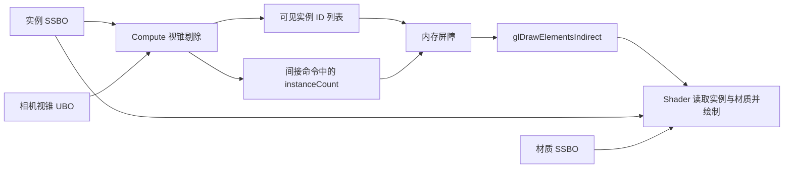

# GPU Driven Rendering

本仓库通过独立的 OpenGL 示例展示 GPU 如何筛选可见对象、组织绘制数据，并生成间接绘制参数。CPU 负责初始化资源、更新相机和调度各个阶段，GPU 决定可见集合以及对应的实例数或命令内容。

## 从实例数据到绘制

以 `indirect_draw` 为例，一帧的数据流如下：

实例数据保存变换、包围体和材质 ID，材质数据保存颜色因子与 Bindless 纹理句柄。Shader 通过材质 ID 读取资源，使同一批实例能够使用不同纹理。对应实现见 [gpu_scene](../src/examples/gpu_scene/main.cpp) 和[材质 Shader](../src/examples/gpu_scene/shaders/gpu_scene.frag)。

剔除后无需重新排列整个实例缓冲区。Compute 使用 `atomicAdd` 为通过测试的实例分配连续位置，只把原始实例 ID 写入可见列表；顶点 Shader 再通过列表找到真正的实例数据。原子追加顺序不固定，因此不能将压缩后的位置当成原始对象 ID。

实现入口：[间接绘制调度](../src/examples/indirect_draw/main.cpp)、[Compute 剔除](../src/examples/indirect_draw/shaders/indicrect_draw.comp)、[可见列表读取](../src/examples/indirect_draw/shaders/indicrect_draw.vert)。

## 各条绘制路径的区别

| 示例 | GPU 输出 | 绘制方式 |
| --- | --- | --- |
| [compute_culling](../src/examples/compute_culling/main.cpp) | 可见实例 ID 和独立计数器 | CPU 同步回读可见计数，再调用实例化绘制 |
| [indirect_draw](../src/examples/indirect_draw/main.cpp) | 可见实例 ID，并累加一条间接命令的 `instanceCount` | `glDrawElementsIndirect` 直接读取 GPU 写入的实例数 |
| [hzb](../src/examples/hzb/main.cpp) | 视锥和遮挡测试后的实例 ID，以及间接命令的实例数 | 同样使用一条间接实例化命令 |
| [meshlet](../src/examples/meshlet/main.cpp) | 每个可见 Meshlet 一条命令，命令紧凑排列 | `glMultiDrawElementsIndirect` 提交固定上限数量的命令，剩余命令预先清零 |
| [mdi_count](../src/examples/mdi_count/main.cpp) | 紧凑命令列表和可见命令计数 | `glMultiDrawElementsIndirectCount` 从参数缓冲区读取本次命令数量 |
| [mesh_shader](../src/examples/mesh_shader/main.cpp) | Mesh Shader 直接输出顶点和图元 | CPU 调用 `glDrawMeshTasksNV`，每个工作组处理一个 Meshlet |

`instanceCount` 表示一条命令绘制多少个实例；MDI Count 的计数器表示执行多少条命令，两者含义不同。`compute_culling` 中的同步回读用于展示计数结果，后续间接绘制示例展示无需 CPU 回读可见数量的提交路径。

在 Meshlet 的紧凑命令列表中，`gl_DrawID` 也不等于原始 Meshlet ID。示例把原始 ID 放在命令的 `baseInstance` 中，让 Shader 能够稳定读取对应数据和配色。

## 写入结果如何交给下一阶段

同一个缓冲区可以先作为 SSBO 由 Compute 写入，再作为间接绘制命令或计数参数使用。其内存布局必须同时满足 CPU、GLSL 和绘制 API 的要求。

示例根据后续访问方式设置 `glMemoryBarrier`：

| 后续访问 | 对应屏障 |
| --- | --- |
| Shader 读取可见列表等 SSBO 数据 | `GL_SHADER_STORAGE_BARRIER_BIT` |
| 间接绘制读取命令或命令计数 | `GL_COMMAND_BARRIER_BIT` |
| `compute_culling` 通过 Buffer API 回读计数 | `GL_BUFFER_UPDATE_BARRIER_BIT` |
| Hi-Z 的下一级 Compute 访问图像、Shader 采样深度 | `GL_SHADER_IMAGE_ACCESS_BARRIER_BIT`、`GL_TEXTURE_FETCH_BARRIER_BIT` |

这些屏障用于保证 GPU 写入对后续访问可见；同步回读仍可能等待 GPU。间接命令的 OpenGL 绑定与调用封装见 [drawable.cpp](../src/framework/src/drawable.cpp)。

## Hi-Z 如何补充视锥剔除

视锥测试只能判断物体是否可能出现在屏幕内，Hi-Z 进一步判断它是否被遮挡。当前 `hzb` 使用一面明确不透明的墙作为遮挡体：

1. 将实心墙体渲染到深度纹理。
2. 将深度复制到 Mip 0，后续每一级归约前一级覆盖区域的最大值。
3. 将实例 AABB 的八个角投影到屏幕，得到覆盖矩形和实例的最近深度。
4. 选择合适的 Mip，读取矩形覆盖区域的最大深度；实例整体更远时才剔除。

这里使用普通深度，近处为 0、远处为 1。保存最大值有助于保守判断：未被墙覆盖的区域仍包含背景远深度，不应据此剔除实例。包围盒跨过相机平面等不可靠投影也会被保留。

最终画面中的墙体线框与遮挡深度独立，便于看见剔除效果。灰度预览直接查看所选 Mip，不改变实际剔除设置。

实现入口：[深度归约](../src/examples/hzb/shaders/hzb_generate_hiz.comp)、[遮挡判定](../src/examples/hzb/shaders/hzb_cull.comp)。

## Meshlet 与 Mesh Shader

Meshlet 是预先划分的一小组顶点和三角形。三个相关示例都使用 meshoptimizer 构建，上限为 64 顶点、64 三角形，并根据原始 Meshlet ID 生成固定颜色。

`meshlet` 和 `mdi_count` 在 Compute 中进行包围球视锥测试，再生成传统索引绘制命令。其中 `meshlet` 还支持 Cone Culling：只有整个 Meshlet 的三角形都背向相机时，才将它提前剔除；跨越正、背面边界的 Meshlet 继续保留。实现见 [meshlet.comp](../src/examples/meshlet/shaders/meshlet.comp)。

`mesh_shader` 使用 `GL_NV_mesh_shader`，没有 Task Shader。CPU 为全部 Meshlet 提交工作组，Mesh Shader 内部做视锥测试；不可见工作组输出零个图元，其余工作组读取局部索引并输出几何。实现见 [mesh_shader.mesh](../src/examples/mesh_shader/shaders/mesh_shader.mesh)。

## 当前范围

当前示例覆盖 GPU 实例与材质读取、可见列表压缩、视锥 / Hi-Z / 法线锥剔除，以及多种绘制提交路径。GPU LOD、GPU 排序和批次构建等功能尚未实现，可在后续加入对应示例时扩展本文。

构建要求、实际运行环境与演示截图见[根 README](../README.md)。
